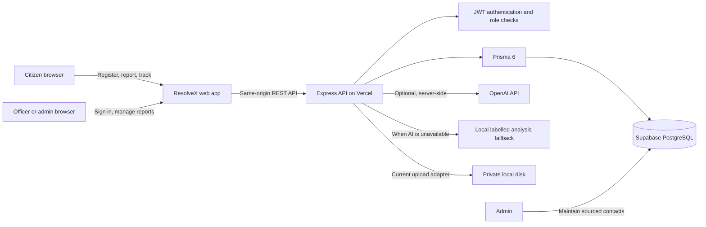

# ResolveX

ResolveX is a Bengaluru civic issue reporting MVP. Citizens can register, submit and track reports, attach private evidence, review AI suggestions, and prepare their own authority contact. Officers can work assigned reports, record status history, and add resolution evidence. Administrators manage staff, departments, sourced contacts, assignments, and public visibility.

The backend uses Express, PostgreSQL, and Prisma 6. Uploaded files are stored outside the public web root. No email, phone call, or grievance submission is sent by ResolveX.

- **Live demo:** <https://resolvex-hackathon.vercel.app/>
- **Public source:** <https://github.com/Rohan-Sreehari/resolvex-hackathon>

## Architecture



The live API health check currently reports a successful database connection. Locally, uploads use `UPLOAD_DIR`. On Vercel, uploads are written to the function's temporary `/tmp/resolvex-private` directory so report submissions can complete; **uploaded images are not durable and may be unavailable on a later request**. Durable hosted media needs a private object-storage service and is not configured. Live AI analysis also requires `OPENAI_API_KEY`; without it, the app uses the labelled fallback. The Mermaid diagram describes the code's current request path and does not imply those optional hosted integrations are configured.

## Requirements

- Node.js 20 or later
- PostgreSQL 14 or later, local or managed
- OpenAI API key only if you want live AI analysis

## Setup

The steps below run ResolveX locally. The deployed demo is linked above; changing local `.env` values does not change Vercel's environment.

1. Install packages (Node.js 20 or later):

   ```powershell
   npm install
   ```

2. Create a PostgreSQL database named `resolvex` (or use an existing database), then copy the environment template:

   ```powershell
   Copy-Item .env.example .env
   ```

3. Edit `.env`:

   - `DATABASE_URL`: PostgreSQL connection string used by the app (pooled is fine if supported by the provider).
   - `DIRECT_URL`: direct PostgreSQL connection used by Prisma migrations. For local Postgres, set it to the same value as `DATABASE_URL`.
   - `JWT_SECRET`: replace with a random secret at least 32 characters long.
   - `OPENAI_API_KEY`: optional. Without it, reports get a clearly labelled local keyword fallback.
   - Optional `SEED_ADMIN_*` and `SEED_OFFICER_*`: set each account's email and a unique password at least 12 characters long to create initial staff accounts.

4. Generate Prisma Client, apply the checked in migration, and seed the directory:

   ```powershell
   npm run db:generate
   npm run db:deploy
   npm run db:seed
   ```

   Optional: set `SEED_DEMO_REPORTS=true` before `npm run db:seed` to add three fictional reports with public summaries clearly marked `DEMO SAMPLE`. An active admin account must already exist. These sample records let judges see categories and pending/resolved counts without mistaking them for citizen submissions.

5. Start ResolveX:

   ```powershell
   npm start
   ```

   Open <http://localhost:3000>. Run `npm run dev` for automatic restarts while editing.

To create a migration after changing `prisma/schema.prisma` during local development, run `npx prisma migrate dev --name describe_the_change`; commit the generated migration. Deploy environments with `npm run db:deploy`.

## Staged local checks

- Database and migration: `npm run db:generate`, `npm run db:deploy`, then `GET /api/health` should return `{ "ok": true, "database": "connected" }`.
- Seed: `npm run db:seed`; `GET /api/departments` should return the Bengaluru authority directory and source records.
- Citizen path: register in the page, submit a report with a typed location and image, review the tracking ID and analysis, then view it in “My workspace”.
- Staff path: sign in with a seeded staff account, assign a report as admin, sign in as that officer, update its status, and upload resolution evidence.
- Public path: approve a report from the staff workspace; it should then appear in the public list and dashboard.

## Core API

All endpoints are same origin. Protected endpoints require `Authorization: Bearer <token>` returned by login/registration. Roles are `CITIZEN`, `OFFICER`, and `ADMIN`; the role is read from a signed token and the active user record, never from a caller supplied role header.

- `GET /api/health`
- `POST /api/auth/register`, `POST /api/auth/login`, `GET /api/auth/me`
- `POST /api/auth/users`, `GET /api/users` — admin only
- `GET /api/departments` — public directory
- `POST/PATCH /api/departments` — admin only
- `POST /api/departments/:id/contacts`, `PATCH /api/contacts/:id` — admin only; each contact requires a secure source URL
- `GET /api/dashboard` — public approved totals and status statistics; indicates when clearly labelled demo samples are included
- `GET /api/audit?limit=100` — admin-only audit feed
- `GET /api/reports?scope=mine` — citizen's reports
- `GET /api/reports?scope=queue` — assigned officer queue or admin queue
- `GET /api/reports/public` — approved, redacted reports
- `POST /api/reports` — multipart form fields `category`, `description`, `location`, optional `latitude`, `longitude`, required `consent=on`, up to three JPEG/PNG/WebP images
- `POST /api/reports/:id/email-draft` — report-owner-only editable AI-assisted email draft; uses a local template if AI is unavailable
- `GET /api/reports/:id` — owner, assigned officer, or admin
- `PATCH /api/reports/:id/status` — assigned officer or admin; writes status history and audit event
- `PATCH /api/reports/:id/assign` — admin only
- `PATCH /api/reports/:id/public` — assigned officer or admin; requires a staff-written public-safe summary before approval
- `POST /api/reports/:id/communication` — report owner; records explicitly citizen reported updates
- `POST /api/reports/:id/media` — owner or assigned staff; staff uploads are tagged as resolution evidence
- `GET /api/media/:id` — report owner, assigned officer, or admin

## AI, privacy, and media

- With `OPENAI_API_KEY`, the server sends report text and up to three attached images to `OPENAI_API_URL` (default OpenAI Chat Completions endpoint) using `OPENAI_MODEL` (default `gpt-4o-mini`). AI results are suggestions with a confidence and explanation; they are not verified facts. Provider failures fall back to a low confidence keyword suggestion and do not block report storage.
- Without a key, no report text or image is sent to an AI service. The local fallback is not presented as AI output.
- This hackathon demo accepts JPEG, PNG, and WebP images only (up to three, 8 MB each). Images are decoded, dimension limited, auto-oriented, and re-encoded before storage and AI analysis. Files stay private and are served only to report owners and authorized staff. Audio and video are postponed.
- Reports require consent to storage and possible AI processing. Browser geolocation is requested only after the citizen clicks the location control; typed landmarks remain available.
- Public report responses omit reporter identity, original descriptions, precise location, staff-only notes, and original media. Staff must write a public-safe summary before approving a citizen report; the public endpoint only exposes that summary and a city-level location. Seeded sample reports are clearly labelled `DEMO SAMPLE` and included in public totals to make the judge demo useful.
- Complaint email drafts are editable; copying or opening an email app does not send them. Phone links and official pages are handoffs only. Citizens make the call and complete the authority form themselves.

## Bengaluru authority directory

The seed includes the official Greater Bengaluru Authority/BBMP homepage, the authority-wide helpline `1533`, the BBMP head-office email listed on its contact page, and a link to the official homepage where Sahaaya 2.0 Public Grievance is listed. These are authority-wide channels, not department-specific case destinations. Each record stores a source URL, verification status, date, and explanatory note.

Initial report routing is limited to categories explicitly associated with public civic services in the cited BBMP/GBA sources. Other categories remain unassigned pending review instead of receiving an inferred contact. Admins can add departments and source-backed contacts through the API. Recheck directory records before relying on them; this seed is not an official government integration.

Official references:

- Greater Bengaluru Authority homepage and Sahaaya 2.0 listing: <https://bbmp.gov.in/>
- BBMP contact page listing phone 1533 and `comm@bbmp.gov.in`: <https://site.bbmp.gov.in/contact.html>
- BBMP Solid Waste Management overview: <https://site.bbmp.gov.in/departmentwebsites/swm/index.html>
- Karnataka administrative reforms document describing Sahaaya 2.0 use for pothole and streetlight grievances: <https://bbmp.gov.in/ucc_file/KarnatakaAdministrativeReforms.pdf>

## Environment variables

See `.env.example` for the complete list:

- Required: `DATABASE_URL`, `DIRECT_URL`, `JWT_SECRET`
- Optional: `JWT_EXPIRES_IN`, `PORT`, `UPLOAD_DIR`, `MAX_FILE_BYTES`, `MAX_TOTAL_UPLOAD_BYTES`
- Optional AI: `OPENAI_API_KEY`, `OPENAI_MODEL`, `OPENAI_API_URL`
- Optional bootstrap accounts: `SEED_ADMIN_EMAIL`, `SEED_ADMIN_PASSWORD`, `SEED_ADMIN_NAME`, `SEED_OFFICER_EMAIL`, `SEED_OFFICER_PASSWORD`, `SEED_OFFICER_NAME`
- Optional demo samples: `SEED_DEMO_REPORTS=true`

Do not commit `.env`, real contact evidence, database dumps, or uploaded media. Local upload storage is not backed up or encrypted at rest by the application; use private object storage and secrets management for a deployed service.

## Hackathon demo limits

- Configure `OPENAI_API_KEY` for live image/description analysis and AI-assisted complaint email drafts. With no key or if the provider is unavailable, ResolveX labels and uses the local keyword/template fallback.
- Email drafts, phone calls, and grievance portals are manual citizen handoffs. ResolveX never sends or submits them.
- Citizen registration is password based; email verification and password recovery are not part of this demo.
- Prisma remains on version 6 as requested. `npm audit` reports three high-severity advisories in the Prisma CLI/config dependency tree; resolving them requires a separately planned Prisma major upgrade. Do not upgrade during the hackathon demo.
